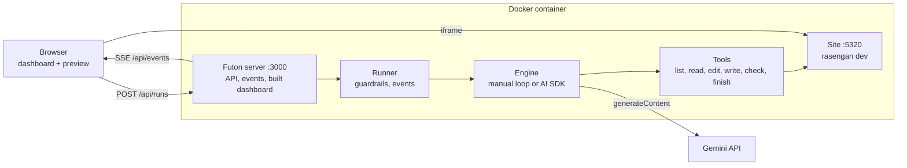

# Architecture

Everything runs in one process plus one child process, in one container. There is no queue, no database and no cloud service besides the Gemini API.

## The pieces

| Piece | Where | Role |
|---|---|---|
| Futon server | `server/src/index.ts` | HTTP API, the SSE event stream, and in Docker the built dashboard |
| Runner | `server/src/agent/runner.ts` | Starts one run at a time, picks the engine, applies the guardrails, turns what happens into events |
| Engines | `server/src/agent/engines/` | The loop itself, written twice behind the `AgentEngine` interface |
| Tools | `server/src/agent/tools.ts` | What the agent can do, defined once with zod and shared by both engines |
| System prompt | `server/src/agent/prompt.ts` | The agent’s brief: role, project, what a good landing page is, how to recover, how to finish |
| Workspace | `server/src/site/workspace.ts` | The site on disk, path checks, `rasengan dev`, type-checking |
| Diagnostics | `server/src/site/diagnostics.ts` | Turns compiler output into short, actionable errors; syntax check after each write |
| Dashboard | `dashboard/` | Rasengan.js SPA: home, studio (timeline, preview, code), loop inspector |
| Template | `template/` | The starter site, copied to `workspace/site` on first start |

## A request, end to end

1. The dashboard sends `POST /api/runs` with the message, the engine, the model and the budget.
2. The runner creates a `RunContext`, builds the tools around it, and calls `engine.run(...)` with the system prompt, the earlier exchanges and the new message.
3. The engine calls Gemini. After each model call it reports the text and token usage (`model_response` event), then runs the tools the model asked for.
4. Each tool call emits `tool_call` and `tool_result` events. Writes go through the workspace, which also emits `site_changed`.
5. `rasengan dev` picks up the change and the preview reloads through Vite’s hot reload.
6. The run ends when `finish` succeeds, the model answers without calling a tool, the budget or step limit is reached, or the user presses Stop. The runner emits `run_finished`.

The dashboard never asks for state: it replays the event stream from the start of the session and rebuilds everything from it. That is also what powers the loop inspector.

## Why one container

The container is the sandbox. The agent only touches the site through its tools, the tools only write under `src/` and `public/`, and anything that goes wrong stays inside. It also keeps the demo simple to run anywhere: `docker compose up`.

## Ports

| Port | What |
|---|---|
| 3000 | Futon: API, events, built dashboard |
| 5300 | Dashboard dev server (`pnpm dev` only) |
| 5320 | The site’s `rasengan dev` (the preview) |
| 6665 | Vite hot reload socket for the preview |
